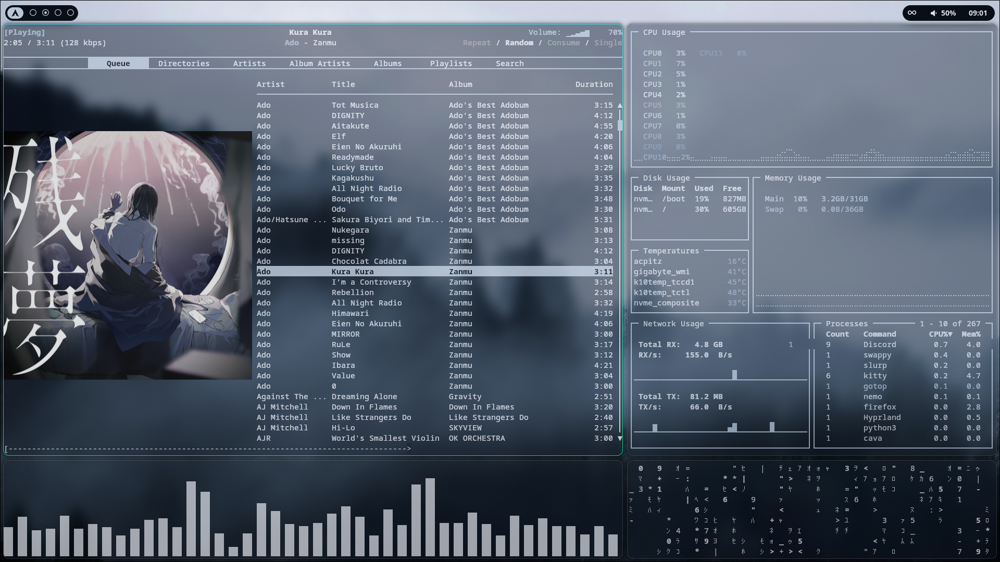
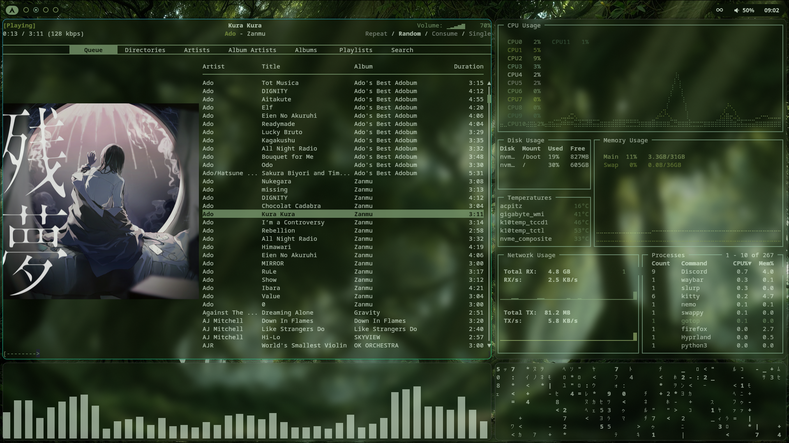

# Manjit's Dotfiles

This contains my **Arch** Linux configuration for *Hyprland*. 


>[!WARNING]
> All configs are meant to be used with `Pywal`


## Showcase:

These are from my older configs but not much has changed so they're still relavant to the overall rice.
<p align="center">
  
  
</p>


## Keybinds

Basic keybinds

| Keybind                 | Action                    |
| ------------------------| ------------------------- |
| `Super + RETURN`        | Terminal                  |
| `Super + Q`             | Close active window       |
| `Super + E`             | File manager              |
| `Super + F`             | Toggle fullscreen         |
| `Super + P`             | Toggle float              |
| `Super + Space`         | Application launcher      |
| `SuperSHIFT + Space`    | Wallpaper selector        |
| `Super + 1, 2, 3..`     | Change workspaces         |
| `Super + Shift + 1, 2..`| Move window to workspace  |
| `Super + B`             | Blender (if installed)    |
| `Super + N`             | ZenNotes (if installed)   |


Move Focus between active windows 

| Keybind                 | Action                    |
| ------------------------| ------------------------- |
| `Super + h`             | Swtich focus left         |
| `Super + l`             | Swtich focus right        |
| `Super + k`             | Swtich focus up           |
| `Super + j`             | Swtich focus down         |


Move window to

| Keybind                 | Action                    |
| ------------------------| ------------------------- |
| `ALT + SHIFT + h`       | Move window left          |
| `ALT + SHIFT + l`       | Move window right         |
| `ALT + SHIFT + k`       | Move window up            |
| `ALT + SHIFT + j`       | Move window down          |


>[!NOTE]
> Use mouse to resize window. Drag corners to resize. 

## Aliases 

Applicaitons 

| Alias      | Command                               | Description                   |
|------------|---------------------------------------|-------------------------------|
| `F`        | `nautilus`                            | Open file manager             |
| `n`        | `nvim`                                | Open Neovim                   |
| `vim`      | `nvim`                                | Use Neovim as Vim             |
| `g`        | `git`                                 | Git shortcut                  |
| `m`        | `rmpc`                                | Open terminal music player    |
| `fetch`    | `fastfetch`                           | Display system information    |
| `stat`     | `btop`                                | Open system resource monitor  |
| `rain`     | `unimatrix -c white`                  | Run Unimatrix in white        |


Scripts and system maintenance

| Alias      | Command                               | Description                   |
|------------|---------------------------------------|-------------------------------|
| `bios`     | `systemctl reboot --firmware-setup`   | Reboot into BIOS/UEFI settings|
| `sysclean` | `~/.config/scripts/sysmaintenance.sh` | Run system maintenance        |
| `sysupdate`| `~/.config/scripts/update.sh`         | Update system                 |
| `audiofix` | `~/.config/scripts/audio_reset.sh`    | Reset audio settings          |


## Installation:

>[!WARNING]
>The installation scripts are AI generated and haven't been tested yet. 
> 
>Even tho I've read through it, use it at your own risk. 
>
>Yes, I'm that lazy. yes, both.

**First install git then use the next command and continue the installation until it's finished.**

```bash
sudo pacman -S git
```

```bash
git clone https://github.com/Manjit-karki/Dotfiles.git
cd Dotfiles/Install
chmod +x install.sh
./install.sh
```


> [!important]
> **Do not move or delete the dotfiles repository after installation.**
>
> This setup uses **symbolic links (symlinks)** that point to files inside the cloned repository. If you move or delete the repository, those symlinks will break.
>
> If you relocate the repository, simply run:
>
> ```bash
> ./install.sh
> ```
>
> The installer will update the existing symlinks to point to the new location.


## Details

- OS: **[Arch Linux](https://archlinux.org)**
- DE: **[Hyprland](https://hypr.land)**
- Terminal: **[Kitty](https://sw.kovidgoyal.net/kitty/)**
- Shell: **[Fish](https://github.com/oh-my-fish/oh-my-fish)**
- Bar: **[Waybar](https://github.com/Alexays/Waybar)**
- App Launcher: **[Wofi](https://github.com/SimplyCEO/wofi)**
- Editor: **[NeoVim](https://github.com/neovim/neovim)**
- File Manager: **[Nautilus](https://apps.gnome.org/Nautilus/)** 
- Fetch: **[FastFetch](https://github.com/fastfetch-cli/fastfetch)**
- Browser: **[Firefox](https://firefox.com)**
